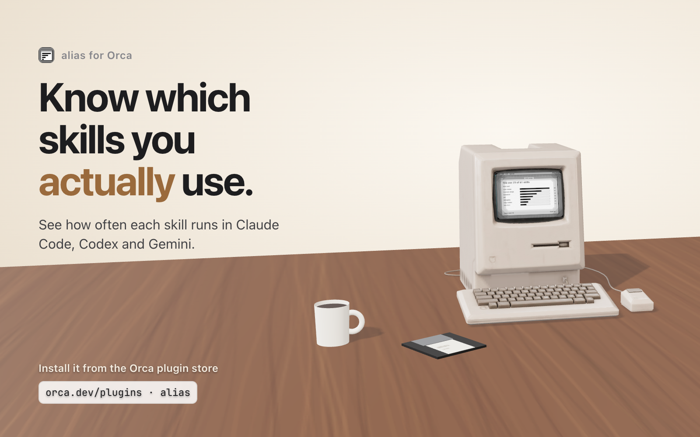

# alias for Orca

See which of your agent skills you actually use. alias counts every skill installed on this machine for Claude Code, Codex and Gemini, and how often each one ran.

- **Most used and never used.** Counted from the logs your agents already keep. Nothing leaves your machine unless you share.
- **Clean up.** Writes the audit to `~/.alias/setup.json` and starts Claude Code in Plan Mode. It reads the audit, finds duplicate, unused and outdated skills, and shows you a plan. Plan Mode cannot change files, so nothing changes until you approve. It installs nothing. Clean up needs Claude Code.
- **Fix broken links.** Shows a command for each skill link that points to a missing folder, or hands them to an agent.
- **Share a profile.** Puts your skill names and use counts on a public page at alias.computer. Link your X account if you want people to know it is you.

## Install

Open [the plugin page](https://orca.dev/plugins/HMDRAMS-DEV/orca-plugin-alias) and press Install. Then open **Skill usage** in the right sidebar.

Pick the agent that Clean up starts under the plugin's settings. It is Claude Code by default.

## Also

- Paseo plugin: [HMDRAMS-DEV/paseo-plugin-alias](https://github.com/HMDRAMS-DEV/paseo-plugin-alias)
- CLI: `npx -y https://alias.computer/alias-skills.tgz audit`
- See what other people use: [alias.computer/skills](https://alias.computer/skills)

MIT licensed.

## Credits

The computer in the listing images is "macintosh" (https://sketchfab.com/3d-models/macintosh-a8a98ce5b4af43ca8f680cb1b005fc5d) by Olli_one, licensed under CC BY 4.0.
